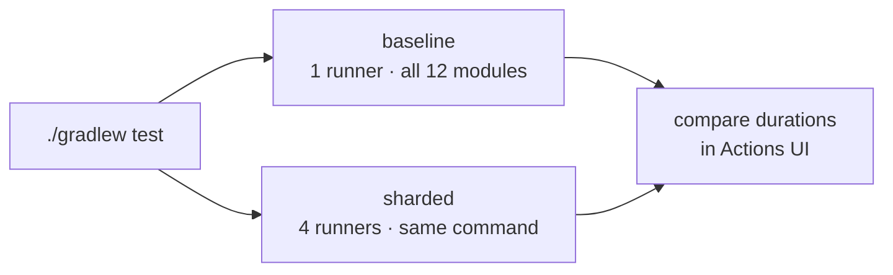
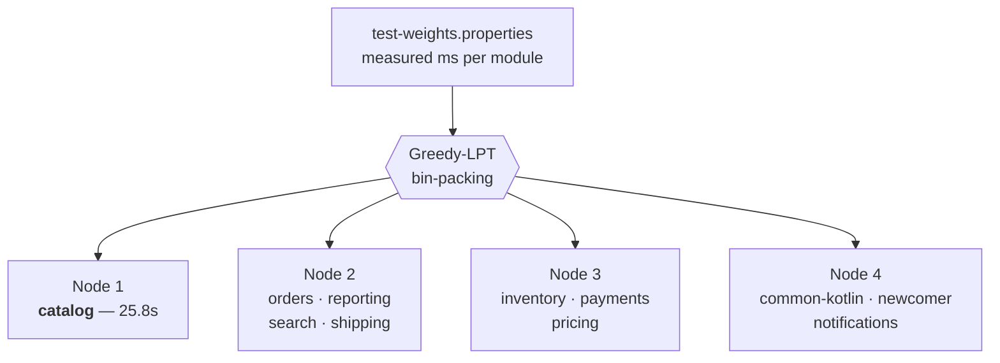
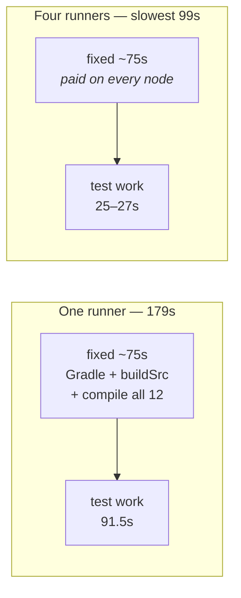
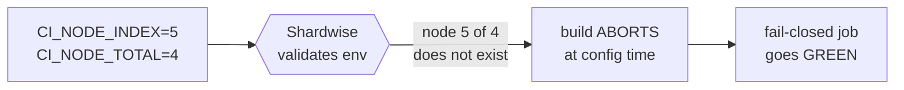
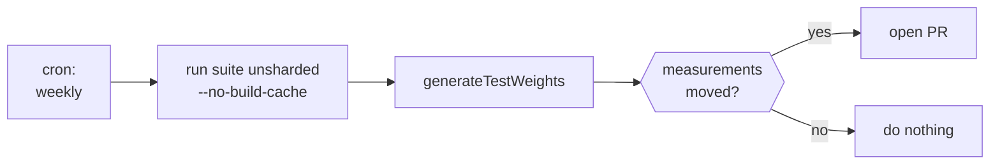

# Shardwise, in a build you can actually run

Twelve-module Gradle build wired to
[Shardwise](https://github.com/micschr0/gradle-test-shard-plugin). See runtime-balanced
test sharding work before deciding whether you want it.

Every CI run does the same suite twice — one runner, then four. **Open the latest run
in the Actions tab, compare the two durations.** That comparison is the whole point.



---

## What the plan looks like

Same command every node. Two env vars differ. Each node prints what it runs.
This is the real distribution from CI — weight-balanced, not count-balanced:



`catalog` alone on node 1 — one heavy module, no cheap padding beside it. Rest packed
to match. Count-based splitting would idle node 1 half the build.

Measured locally — cold `build/`, warm Gradle home, `--no-build-cache`, no daemon:

| | wall clock | of which test tasks |
|---|---|---|
| One runner, all twelve modules | **179 s** | 91.5 s |
| Four runners, slowest node | **99 s** | 25–27 s |

**1.8x on four runners.** Not 4x. Gap between those columns = fixed cost:



~75s fixed every run: start Gradle, build `buildSrc`, compile all twelve. Shardwise skips
the `test` task, not its dependencies. Every node still compiles the whole build. No
scheduler divides that.

Test work divides near-perfect — 91.5s across four nodes lands 25–27s each. Floor is
`catalog`: 25.8s, cannot split. `./gradlew shardwiseAnalyze` reports the imbalance —
**3.05x**, `catalog` holds **30.4%** of the total.

**Honest rule:** sharding pays when test time is large next to compile time. Measure both
before buying runners.

---

## Four situations this repo shows

| Situation | Module | What it proves |
|---|---|---|
| **One module dominates** | `catalog` | 30% of the suite alone. Weight-split puts it solo on node 1; count-split would pad it with cheap modules and idle the node. |
| **Unknown module** | `newcomer` | Absent from the weights file (stands for the module added after the last refresh). Still planned onto node 4 via `defaultWeight`. |
| **No tests at all** | `bench-support` | No `test` task. Appears in the plan, costs nothing. Nothing to configure. |
| **Mixed languages** | `common-kotlin` | Kotlin, rest is Java. Planner works on module paths, does not care. |

Coverage beats balance. Worst failure of a sharding tool is not a slow build — it is a
module that runs on **zero** nodes while CI shows green. `newcomer` never vanishes.

---

## The failure that must be loud

Dangerous failure mode is not slow — it is a build that silently runs **nothing** while
CI reports green. A misconfigured node index must abort, not shrug.



The [`fail-closed`](.github/workflows/ci.yml) job sets `CI_NODE_INDEX=5` against
`CI_NODE_TOTAL=4` — a node that does not exist. Passes **only when the build fails**:

```text
> CI_NODE_INDEX=5 is out of range 1..4. Shardwise expects 1-based node indices;
  for 0-based CI providers (CircleCI, Buildkite) map the index with +1.
```

Rejection happens at configuration time, before a test compiles. Green check here =
a broken CI environment can never quietly skip your tests.

---

## Weights go stale — refresh on a schedule

`test-weights.properties` holds measured milliseconds per module. Only as good as its
last measurement. Nothing breaks when it rots — nodes just drift apart again.



[`weights-refresh.yml`](.github/workflows/weights-refresh.yml) runs the suite unsharded
weekly, opens a PR when numbers moved. Most integrations leave this out.

Two details worth stealing:

- Measurement run needs `--no-build-cache`. Cached test task reports no duration — you
  would commit a weights file full of zeroes.
- Generated file carries a timestamp comment, so `git diff --quiet` is never empty.
  Compare measurement lines only, or you open a no-op PR every week.

---

## Copy this into your own build

Three things. None touch your modules.

**1. Apply the plugin to the root project:**

```kotlin
// build.gradle.kts
plugins {
    id("de.micschro.shardwise") version "0.4.1"
}
```

**2. Measure once, commit the result:**

```bash
./gradlew test --no-build-cache
./gradlew generateTestWeights      # writes test-weights.properties
```

**3. Set two env vars per CI job** — see [`ci.yml`](.github/workflows/ci.yml) for the matrix:

```yaml
env:
  CI_NODE_INDEX: ${{ matrix.node }}   # 1-based
  CI_NODE_TOTAL: '4'
```

That is the entire integration. Removing it = deleting the plugins line.

---

## About the workload

Tests do real, deterministic CPU work — chained SHA-256 rounds in
[`bench-support`](bench-support/src/main/java/bench/Workload.java), not `Thread.sleep`.
Sleeping tasks cost no CPU; any scheduler looks good against them, so the numbers would
be a lie.

Durations are deliberately unbalanced — that is the situation Shardwise addresses. A
suite where every module costs the same gains nothing here. Domain names are decoration;
no application under them.

`Workload.UNIT` is the calibration knob — one unit ≈ one second on a GitHub-hosted
runner. On different hardware the whole suite scales with it.

---

## License

Apache-2.0, same as the plugin.
