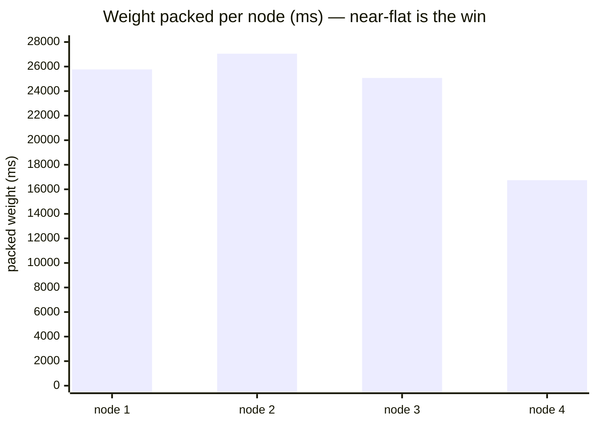
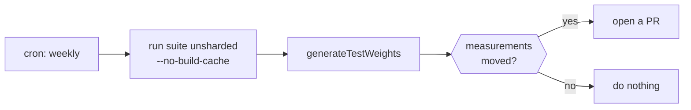

# Shardwise, in a build you can actually run

[](https://github.com/micschr0/shardwise-example/actions/workflows/ci.yml)
[](https://securityscorecards.dev/viewer/?uri=github.com/micschr0/shardwise-example)
[](LICENSE)

**Slow test suite? Shardwise splits it across parallel CI runners** — packing modules by
their **measured duration**, not module count, so a fast runner never sits idle next to a
slow one. This is a twelve-module Gradle build running it for real, so you can judge it
before adopting it.

Every push runs the same suite twice — **one runner, then four** — so the two wall-clock
times sit side by side. That comparison is the whole point.

👉 [**See it in the latest green run**](https://github.com/micschr0/shardwise-example/actions/workflows/ci.yml?query=branch%3Amain+is%3Asuccess)
— compare `baseline` (all tests, 1 runner) to any `sharded (node 1 of 4)` job; each job
header shows its wall-clock time.

**Jump to:** [the number](#the-one-number-that-decides-it) ·
[why weight beats count](#why-weight-based-packing-beats-module-count) ·
[fail-loud guarantee](#the-failure-that-must-be-loud) ·
[copy it into your build](#copy-this-into-your-own-build) ·
[try it locally](#try-it)

---

## The one number that decides it

On GitHub-hosted runners, measured across real CI runs (they vary with runner load):

| | wall clock |
|---|---|
| `baseline` — 1 runner, all 12 modules | **~120–190 s** |
| `sharded` — slowest of 4 nodes | **~75–145 s** |

Roughly **1.3–1.8×** (needs JDK 17; the Gradle wrapper is committed, nothing else to
install). Locally, on a quiet machine: **179 s → 99 s = 1.8×**.

Not 4×. **Here is why — and the reason matters more than the number:**

```mermaid
gantt
    title Where the wall-clock goes (mm:ss)
    dateFormat X
    axisFormat %M:%S
    todayMarker off
    section 1 runner
    fixed ~75s (Gradle + compile all 12)  :done, 0, 75
    test work 91.5s                       :active, 75, 167
    section 4 runners (slowest node)
    fixed ~75s — paid on every node       :done, 0, 75
    test work 25s                         :active, 75, 100
```



Both grey bars are the same length. **That fixed ~75 s — starting Gradle, building
`buildSrc`, compiling all twelve modules — is paid on every node and no scheduler can
divide it.** Shardwise skips the `test` task, not the tasks it depends on.

Only the test work shrinks: 91.5 s → 25 s across four nodes. **The honest rule:
sharding pays when your test time is large next to your compile time.** Measure both
before buying runners.

---

## Why weight-based packing beats module count

The planner packs by real milliseconds (Greedy-LPT bin-packing), so heavy modules get
isolated instead of stacked. This is the actual distribution from CI:



`catalog` (25.8 s, ~30 % of all test time) sits **alone** on node 1. Three nodes land
within noise of each other. Split by module *count* instead and node 1 gets `catalog`
plus two cheap modules — idle runners everywhere else while node 1 carries the build.

---

## The failure that must be loud

The dangerous failure mode of a sharding tool is not a slow build — it is a build that
silently runs **nothing** while CI reports green. A misconfigured node index has to
**abort**, not shrug.

The [`fail-closed`](.github/workflows/ci.yml) job proves it: it sets `CI_NODE_INDEX=5`
against `CI_NODE_TOTAL=4` — a node that does not exist — and **passes only when the build
fails**, at configuration time, before a single test compiles.

```text
> CI_NODE_INDEX=5 is out of range 1..4. Shardwise expects 1-based node indices;
  for 0-based CI providers (CircleCI, Buildkite) map the index with +1.
```

A green check on that job is the guarantee a broken CI environment can never quietly skip
your tests.

---

## Four things this repo puts under test

| Situation | Module | What it proves |
|---|---|---|
| **One module dominates** | `catalog` | 30 % of the suite alone → weight-split isolates it on node 1; count-split would pad it and idle the rest. |
| **Unknown module** | `newcomer` | Absent from the weights file (the module added after the last refresh). Still planned via `defaultWeight` — never runs on zero nodes. |
| **No tests at all** | `bench-support` | No `test` task. Appears in the plan, costs nothing, needs no config. |
| **Mixed languages** | `common-kotlin` | Kotlin among Java. Planner works on module paths; does not care. |

**Coverage beats balance** is the invariant behind all four: an unknown module, an unknown
task name, a stale weight — all default to *running*, never to silently vanishing.

---

## Weights go stale — refresh on a schedule

`test-weights.properties` is only as good as its last measurement. Nothing breaks when it
rots; the nodes just drift apart again until you are back where you started.



[`weights-refresh.yml`](.github/workflows/weights-refresh.yml) does this weekly. Two
details worth stealing:

- The measurement run needs `--no-build-cache` — a cached test task reports no duration
  and you would commit a weights file full of zeroes.
- The generated file carries a timestamp comment, so `git diff --quiet` is never empty.
  Compare the measurement lines only, or you open a no-op PR every week.

---

## Copy this into your own build

Three things. None touch your modules.

**1. Apply the plugin to the root project** (version `0.4.1` — the latest on the Gradle
Plugin Portal; bump only after confirming a newer one resolves):

```kotlin
// build.gradle.kts
plugins {
    id("de.micschro.shardwise") version "0.4.1"
}
```

**2. Measure once and commit the result** (re-run after a dependency bump or a test-shape
change; the weekly refresh above keeps it honest between times):

```bash
./gradlew test --no-build-cache
./gradlew generateTestWeights      # writes test-weights.properties
```

**3. Set two env vars per CI job** — see [`ci.yml`](.github/workflows/ci.yml) for the matrix:

```yaml
env:
  CI_NODE_INDEX: ${{ matrix.node }}   # 1-based
  CI_NODE_TOTAL: '4'
```

That is the entire integration. Removing it is deleting the plugins line.

---

## About the workload

The tests do real, deterministic CPU work — chained SHA-256 rounds in
[`bench-support`](bench-support/src/main/java/bench/Workload.java), never `Thread.sleep`.
Sleeping tasks cost no CPU, so any scheduler looks good against them; the numbers would be
a lie. Durations are deliberately unbalanced — a suite where every module costs the same
gains nothing here. The domain names are decoration; there is no application under them.
`Workload.UNIT` is the calibration knob: one unit ≈ one second on a GitHub-hosted runner.

---

## Try it

```bash
git clone https://github.com/micschr0/shardwise-example
cd shardwise-example
CI_NODE_INDEX=1 CI_NODE_TOTAL=4 ./gradlew test   # node 1 runs only catalog
```

One shard on your laptop runs a *subset* — node 1 is just `catalog` (~25 s of test work),
the other eleven modules show `SKIPPED`. That proves the split works, but the **speedup is
a comparison**, and your laptop is one machine, not four. To see it on one machine, time
the baseline against the slowest shard:

```bash
time ./gradlew test --no-build-cache                              # baseline: all 12 modules
for n in 1 2 3 4; do
  time CI_NODE_INDEX=$n CI_NODE_TOTAL=4 ./gradlew test --no-build-cache
done                                                             # slowest of these ≈ your sharded wall-clock
```

Confirm the guarantees while you are there: every module lands on exactly one node (no
silent skip), and an out-of-range index fails loudly —
`CI_NODE_INDEX=99 CI_NODE_TOTAL=4 ./gradlew test` must abort, not run nothing.

Or skip all of it and [**open the latest CI run**](https://github.com/micschr0/shardwise-example/actions/workflows/ci.yml?query=branch%3Amain+is%3Asuccess)
— the two durations are right there in the job headers. That is the whole pitch.

## License

Apache-2.0, same as the plugin.
